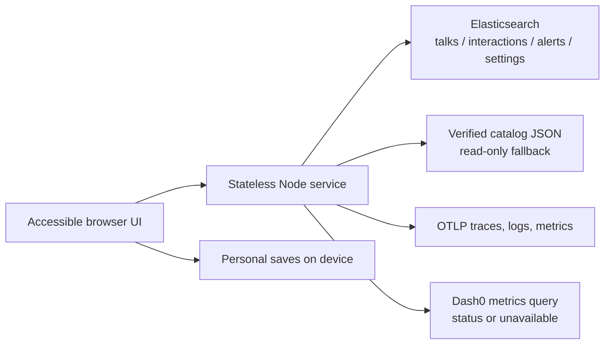

# Overflow

A conference field guide for KubeCon + CloudNativeCon North America 2026. Find a talk, keep a personal plan, and find an alternative before walking to another room.

**Current state:** local build, not deployed. Uses 470 real public schedule entries with explicit snapshot fallback. Live room signals, provider telemetry and ranking evaluation are not yet verified. This build began on **November 8, 2026**, before the official November 9 coding window; no competition-eligibility claim is made.

## Run locally

Requires Node 22+ and Python 3.10+ (Python only for tooling).

```sh
npm ci --prefix app
npm --prefix app start
```

Open [localhost:8080](http://localhost:8080). No credentials required. Search and Plan B use the checked-in catalog. Personal saves stay in your browser on this device and do not count toward room pressure.

```sh
npm --prefix app test
node --test scripts/telemetry.test.cjs scripts/status-provider.test.cjs
node scripts/otlp-smoke.cjs
python3 -m unittest discover -s scripts/tests -v
python3 scripts/smoke.py http://127.0.0.1:8080
```

For the host-timezone checks, run the Node suite with `TZ=UTC`, `TZ=America/Denver`, and `TZ=Asia/Tokyo`. CI contains this matrix. Docker is configured for Node 22, but a local image build requires Docker.

## What works and what the data means

- Query titles, abstracts, speakers and topics; filter by conference day and track.
- Open session details, save a personal itinerary, and inspect up to three Plan B options.
- Every alternative starts within 10 minutes of the original, is in another room, has not ended and has no known full signal. Same-floor preference also requires the same venue.
- Cloud search modes degrade explicitly through reranked hybrid, hybrid, BM25 and snapshot. A mode label describes the query actually executed.
- Capacities are a **uniform estimate of 200**, not venue measurements. Every fullness value carries its denominator and `capacity_source: estimate`.
- Without live interactions, room counts are unknown, not zero. Snapshot alternatives are not guaranteed to have space.
- With verified Elasticsearch interaction data, the heuristic marks likely full at bookmarks/capacity ≥1, or two distinct recent full reports within 10 minutes. Smoke identities are excluded.

The [official schedule](https://events.linuxfoundation.org/kubecon-cloudnativecon-north-america/program/schedule/) links a public Sessionize API. The source contained 600 entries; 480 had speakers, abstract, room and times; excluding 10 simultaneous poster entries left 470. These are measured catalog counts, not attendance statistics. See [data provenance](app/data/SOURCE.md) for scope and timestamp conversion.

## Architecture



No LLM runs in a user request. The server uses native HTTP/fetch. Only `app/public/js/api.js` calls browser APIs. Backend credentials never enter the public configuration.

## Eight invariants

1. Store and return UTC times ending in `Z`; use America/Denver for display/day filters.
2. Reject overlapping talk intervals in the same room during ingestion.
3. Every search and Plan B response contains truthful `mode` and `degraded` fields.
4. Plan B never returns the same session, same room, ended session or a known full room.
5. Crowd estimates always show counts, capacity denominator and estimate provenance.
6. Liveness/readiness probes perform no outbound calls.
7. Private keys/tokens remain server-side; unavailable dependencies degrade visibly.
8. Browser API paths are declared in `contract/api.json`; input validation and meaningful tests cover the boundaries.

## Connect services

Use `.env.example` for names, never commit real values. For local use, Node's `--env-file` can load a private file:

```sh
node --env-file=/absolute/path/to/private.env --require ./app/telemetry.cjs app/server.js
```

Elasticsearch requires an actual endpoint, scoped API key and populated indices. Ingestion must pin an inference endpoint that exists in the target account; no endpoint is assumed from a tutorial. The evaluation tooling starts with no approved queries and no human labels; no ranking results are fabricated. See [evaluation](eval/README.md).

See [observability](observability/README.md) for OTel and Dash0 setup. A successful local collector test proves exports, not ingestion into Dash0. Browser RUM and account resources still require implementation/verification as recorded there.

The original Kubernetes/Argo CD starter is retained. Team/repository placeholders are intentionally unresolved until an actual owned destination is supplied. Never push to `upstream` (the public template). The requested `overflow-cnh/overflow` was not accessible during this build, and Radar/Dash0 tools were not connected. No cluster or cloud-account mutation occurred.

## Accessibility

Semantic landmarks, labeled inputs, native dialogs, keyboard focus, status announcements, text room-status labels, minimum 44px controls, and reduced-motion styles are part of the UI. Responsiveness and agent-operated browser QA are recorded in `docs/qa.md` when complete. This does not substitute for a human assistive-technology evaluation.

## Evaluation and judging evidence

The initial evaluation state is **not measured, n=0**. Suggested queries are agent-drafted and kept separate from approved queries. Human labels are required before reporting Recall@10, MRR or a winning search arm. Pooled recall is relative to the judged pool, not complete-corpus recall.

No Gitar-reviewed PR, Agent0 finding, Radar investigation, remote deployment, or Dash0 dashboard is claimed. [Evidence register](docs/evidence-status.md) separates local checks from external proof still needed.

## What breaks

| Failure | Behavior |
|---|---|
| Elasticsearch missing/unreachable | Snapshot results and explicit degradation; shared writes unavailable |
| Semantic inference/rerank fails | Next actually executed mode returned and degradation shown |
| No crowd observations | Unknown state; alternatives never promise an empty room |
| Dash0 missing, invalid data, or throttled | Status unavailable; bounded retries/backoff; no fake zeroes |
| Browser storage unavailable | UI should explain device-save failure; no cloud persistence implied |
| Data ages or conference has ended | Snapshot provenance remains visible; ended sessions excluded from Plan B |

## AI and human contributions

Codex and specialized coding/research agents authored the implementation and performed automated and agent-operated manual QA. The public [Radar starter](https://github.com/skyhook-io/cnh-starter) is prior third-party work. Gitar, Agent0 and Radar did not perform work in this session. Git history records commits; no author counts are invented.

The user's observed contributions are the supplied reference briefs, the start-now/QA/design direction, and the palette choice. See [human log](docs/human-log.md), [decisions](docs/decisions.md), and [lessons](docs/lessons.md). Future relevance labels, cloud setup, video recording, and submission must be recorded only when actually performed.

The [published rules](https://www.wemakedevs.org/hackathons/cnh/rules) govern competition eligibility. Starting early was the user's explicit instruction; this README preserves the actual chronology.
